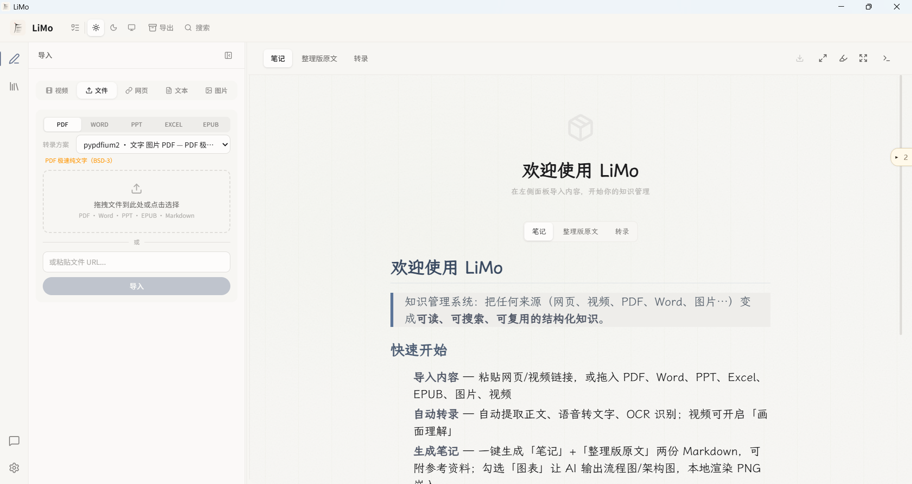
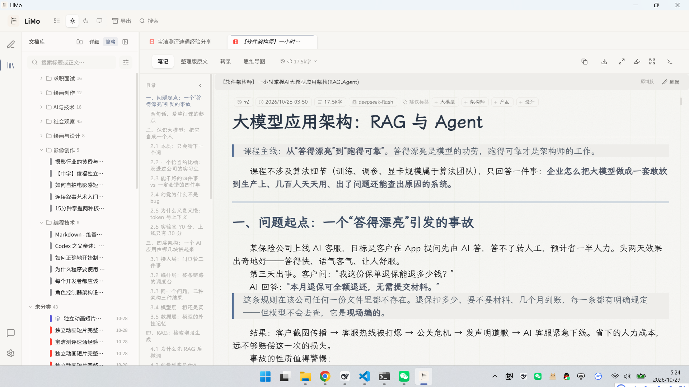
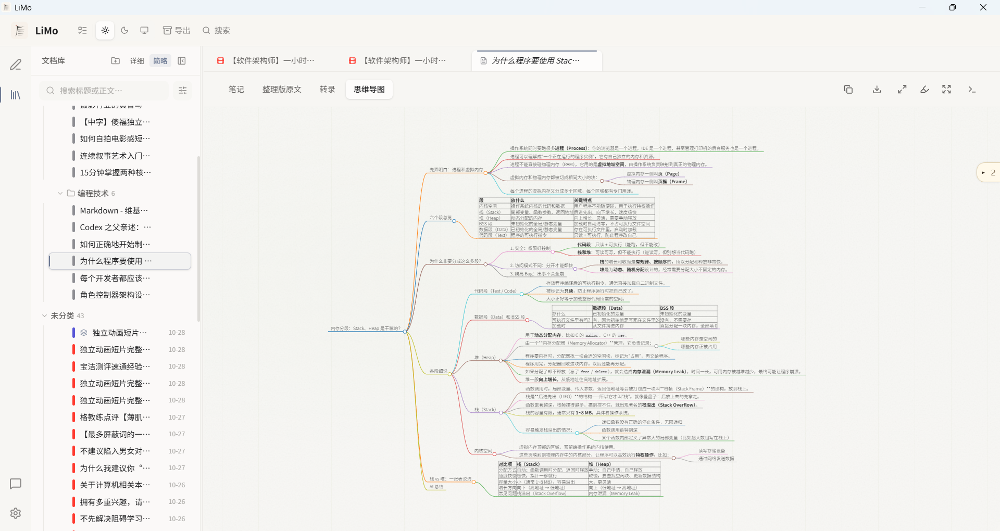
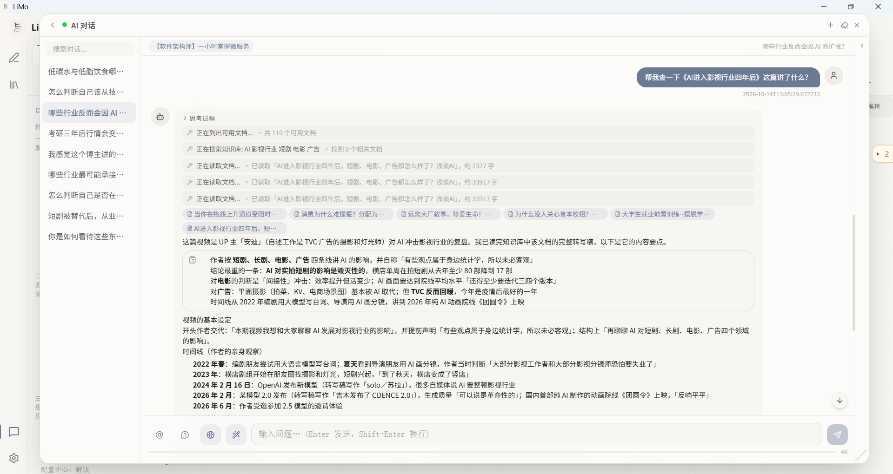
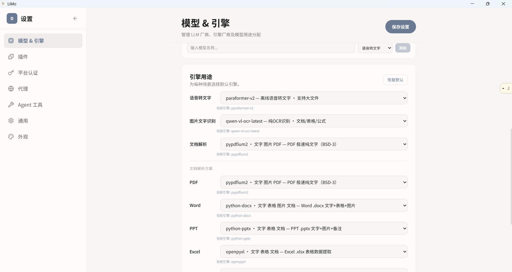
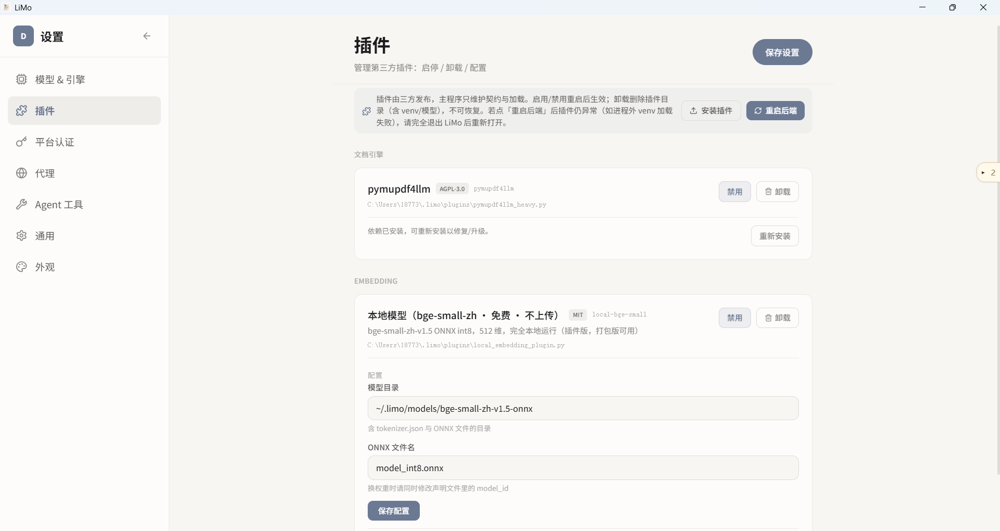

# LiMo（沥墨）

粘贴链接或拖入文件，自动提取正文、语音转文字、生成 Markdown 笔记。

> **想先看看长什么样？** [在线演示站](https://lazybone404.github.io/LiMo/) 里跑着一份完整的界面——文档、文件夹、搜索、主题、合成、对话都能点，不用安装、不用填 API Key。里面的内容是固定的演示数据，不会保存你的操作。



---

## 能做什么

### 导入内容

把网址、本地文件、纯文本粘贴进去就行。支持这些格式：

- **网页**：贴 URL，自动提取正文
- **订阅源**：贴 RSS / Atom 地址，把最新的若干条（最多 20）合成一篇——每条一个标题、链接、摘要。适合把每天要看的更新攒成一份再交给 AI 生成笔记
- **arXiv 论文**：贴 `arxiv.org/abs/…` 或 `arxiv.org/pdf/…`，自动换成 PDF 链接拉全文，效果和直接导入一个 PDF 一样
- **视频**：B 站、YouTube，或本地 mp4/mkv。自动下字幕或语音转文字
- **文档**：PDF、Word、PPT、Excel、EPUB。导入即转录，自动提取文字和表格
- **图片**：PNG、JPG 等，OCR 识别文字
- **文本**：直接粘贴 Markdown 或纯文本

文件可以直接拖进窗口，最大支持 2GB。EPUB 还能「一键解读」：逐章理解后再归并出全书总结，中途断了可以接着跑。

重复导入会被拦下——同一个网址、同一份内容都不会入库两次。

### 转录引擎

系统内置轻量转录引擎，开箱即用：

- 语音转文字（ASR）：bcut-asr（B 站免费，无需 Key）、dashscope-asr（阿里云）
- 文档提取（Doc）：pypdfium2（PDF 默认，BSD-3）、pdfplumber（表格）、pdf-image（扫描件整体转图片）、markitdown（Office/EPUB 通用）、python-docx/pptx（Word/PPT）、openpyxl（Excel）、epub-container（EPUB 章节提取，自研）
- 图片识别（OCR）：dashscope-ocr（阿里云，需 Key）

需要更强的 PDF 解析（文字+图片+矢量图完整提取）？装**三方插件** pymupdf4llm：从[插件仓库](https://github.com/lazybone404/limo-pymupdf4llm-plugin)下载 zip → 设置页「插件」→「**安装插件**」选 zip → 重启 → **一键安装**依赖即可。

引擎可以在设置里换，每种文件类型独立绑定。切换后点「重新转录」重新提取。

### 生成笔记

转录完成后点「生成」，AI 会同时产出两份 Markdown：

- **笔记**：结构化整理，可选目录、时间戳、公式集、图表、参考文献等
- **整理版原文**：修正错别字、去掉口语词，适合存档

笔记默认写成**通俗易懂**的风格，也可以在设置里换成严谨详细、会议纪要、学术等风格；目标语言支持八种。勾选「图表」时，AI 会按内容自己选图型——**依赖网络、带分支的流程、带判定的状态迁移**三种，坐标和排版由程序算，不会画歪。层级、分类、四象限、一问一答的时序这类**用列表就能说清**的关系不画图，改用嵌套列表或对应的内容块，更省更快。勾选「追问卡片」时，笔记末尾会附上几个读完自然会想问的问题，点一下就能带着这篇文档去问 AI。

视频可以开启画面理解——AI 边看画面边写笔记，比如 PPT 里的图表、代码演示。Excel 生成数据摘要（概况、指标、字段解读）。PDF 也可以不进正文提取、直接把原件交给模型读（适合理路复杂的排版和扫描件）。

生成笔记时可以附上参考资料（如视频评论区观点、你想让 AI 审阅的材料）——参考资料作为背景注入笔记生成，与原文/模型判断为准。参考资料太长装不下时，会先自动摘要再注入，并在界面上说明。

同一个位置还可以勾选**联网检索**：生成前 AI 会先从正文里挑出几个关键词去网上搜一圈，把搜到的摘要连同来源链接一并当作参考资料注入笔记。适合需要补充背景、了解最新进展，或者材料本身信息量偏少的题材。搜不到东西不会影响生成，只会在结果里说明一句。

生成时可以看到实时输出，支持中途取消、断点续写。每次生成都会存成一个新版本，**历史版本全部保留**，可以随时切回任意一版。

### 文档库



导入的东西都在文档库里，可以这么整理：

- **文件夹**：可以嵌套，分组头上就能新建子文件夹（右键还有重命名 / 移动 / 删除）。点一个文件夹看到的是**它和它下面所有子文件夹**里的文档；删文件夹会把整棵子树一起收起，里面的文档全部退回未分类——**不会删文档**。文件夹只是分类，不会动磁盘上的文件
- **标签**：一篇可以打多个，筛选区里按标签挑。笔记顶部（版本、字数那一排旁边）会提示**建议标签**——在你库里已有的标签里，挑出这篇正文真提到过的几个，点一下就加上。不想加就放着，它不改正文、不改文件夹归属，也不参与导出
- **全文搜索**：`Ctrl+K` 或点顶栏搜索框，边打边过滤。搜的是正文和笔记内容，命中处会给出上下文片段。万一检索索引出了问题，打开文档库时顶部就会直接说明（而不是装作「没搜到」），旁边就有「重建索引」按钮（想看得更细，**设置 → 通用 → 检索索引** 里有篇数、体积和上次重建时间）；搜索失败时列表底部也会再说明一次。重建只扫文档、不改动它们
- **语义检索**（默认关闭）：在 **设置 → 通用 → 检索索引** 里开启。开启后搜索会把「字面命中」和「意思相近」两路结果一起排——一个词都没出现、但讲的是同一件事的文档也可能被找出来。用哪个模型来算「意思」可以选：**云端**是把文档正文与最新版笔记发出去、按字数计费（首次为全库建一次索引，之后只编码新增和改过的）；**本地**全部在这台电脑上算，不上传、不花钱、断网也能用，代价是要自己准备运行环境：`onnxruntime` 与 `tokenizers` 两个包，以及放在 `~/.limo/models/bge-small-zh-v1.5-onnx/` 的模型文件。这两样都不随安装包分发。源码运行的话，按设置页给出的命令装好、重启即可；桌面安装版本身没有 pip，但可以装**本地向量化插件**（设置 → 插件 → 安装插件，插件带自己的运行环境，装好后同样离线可用），不想装插件就选云端。缺什么、为什么用不了，设置页会直接写出来，不会假装可用。两种模型算出来的向量不能混用，换模型后要重建一次向量索引，这一步不会自动发生。索引文件都存在本机，删文档时对应向量一并清掉。用本地模型时还能顺便决定**模型算完之后要不要留在内存里**（同一张卡上的「模型内存」）：默认「闲置后释放」——建完索引、一段时间没人搜就释放掉，下次搜索再载回来；也可以选「常驻内存」（之后每次搜索都不必等，代价是那几十 MB 一直占着）或「建完即释放」（内存立刻降下来，代价是下一次搜索要等几秒重新载入模型）。云端模型的「模型」跑在服务端，本机不占，所以只有选本地模型时才会看到这一项。同一张卡上还有**建索引时机**：默认「攒够一批自动建」——待索引的文档攒到 100 篇（这个数可以改）才加载一次模型统一处理，免得为一两篇反复把模型载进来又放出去；也可以改成「只在手动时建」，那就只有你自己点「立即建立索引」才会跑。不管选哪一档，「立即建立索引」按钮一直都在，旁边会显示还有几篇待索引，点一下只补还没建的部分（建过的不重算、不重复花钱）。要是某几篇在编码时失败过（断网、额度用尽之类），连续失败三次后它们会停下来不再自动重试，这时按钮旁边会多出一个「**重试失败项 N**」，点它就把这些篇目重新排进队列再试一轮——已经建好的部分不必重算。关掉它，上面的全文搜索照常工作
- **筛选**：文件夹范围、文件类型、标签、标题关键词、日期范围——五组可折叠，收起来时标题行还显示当前筛了什么
- **排列与排序**：排列管怎么归类（平铺 / 按文件夹 / 按类型 / 按时间），排序管组内先后（时间 / 标题 / 类型 / 相关度），两个旋钮互不干扰
- **多选与批量**：点行首那一列（不用瞄准小勾）直接选中，按住 `Ctrl` 从上往下拖可以整段划选——从**已选中**的行起拖是整段取消，从没选中的行起拖是整段加选；划到一半滚动列表，没动鼠标的那一段也会跟着续上。划选按**屏幕上看到的那几行**算（收起的文件夹组不会被划进来），松手后马上点别的行也照常打开。`Shift` 选区间、`Ctrl+A` 全选。文件夹同样能多选（点分组头左侧那一列，`Shift` 选一组），选中的文件夹可以批量移动或删除；移到它本来就在的位置会直接告诉你「无需移动」，不会假装移动了一下。删除确认框按 `Esc` 就能取消。单击行本身永远是**打开文档**，不会动你的选择。选中文档后可以批量删除、打标签、移动
- **智能分类**：选中一批文档，先选好策略（看多少内容、要不要新建文件夹、新建几个、细分几层），按「开始分析」AI 才发出建议，你逐条改完再应用。它可以直接建议多层的文件夹路径（比如「技术/前端」），缺的层会自动建——细分程度默认只到一级子文件夹，想更细就在开始分析前把它调到两级；你自己已经建好的更深分类不会被退回浅层

列表有两种密度：**详细**（卡片，带摘要）和**简略**（26px 单行，按文件夹排成文件树）。文档上千篇也不会卡——列表分批渲染。

### 多篇合成

在文档库里选中两篇以上，点「合成」。**材料装得下时，对话框就是最简单的样子**：只有标题和「合并」按钮，选好几篇、点一下，完事；其余选项收在「调整选项」后面，想微调再展开。材料多到装不下时这些选项会自动展开，并说清哪些篇会被压缩或截断——该知道的事不会被藏起来。

产物是一份跨文档的对比综述。比如把几篇同题论文放一起，得到一份「这批材料放在一起说明了什么、分歧在哪、各篇讲什么」的文章。

- 合成产物**就是一篇普通文档**，可以搜索、打标签、放进文件夹、导出、被对话引用，和别的文档没有区别
- 材料不多时直接合并给模型读；材料多到装不下时，先按维度逐篇抽取再汇总，被压缩过的篇目会在文中标注出来
- 点「调整选项」可以指定**读者意图**（理解主题 / 梳理观点 / 比较材料 / 找争议 / 提炼行动建议 / 自定义）、**原料**（用原文还是用已生成的笔记）、**维度**（通用资料 / 论文 / 技术 / 产品 / 观点，也可以自己写），以及材料属于哪种体裁
- **选什么意图，文章就怎么组织**——选「比较材料」得到按比较轴展开的简报，选「找争议」得到按冲突点展开的分析，选「提炼行动建议」得到结论、依据、行动与失效条件。对话框里会显示当前形态；材料其实不支持这种形态时（比如高度一致却选了「找争议」），文章会直说，不会硬凑
- **依据可展开**：关键论断下面挂着折叠的证据（方法、样本、范围、局限、反例），不展开不影响读完正文，想核对时点一下
- 产物末尾有「各篇速查」：按维度列出每篇各自的说法，一眼扫完，不用通读

合成只负责建文档，不直接生成——你可以先核对着看一遍，再自己点「生成」。

### 阅读与界面



- **文档多标签页**：像编辑器那样，单击是预览（可被下一次单击替换，标题显示为斜体），双击就钉住常驻；右键能关闭其他/全部
- **字号缩放**：`Ctrl+滚轮` 或 `Ctrl+=` / `Ctrl+-` / `Ctrl+0` 调整正文字号，只影响阅读区（AI 对话的消息另有一份自己的字号，在消息区里 `Ctrl+滚轮` 调）。配合「每行字数」「行高」「段落间隔」三个阅读版式旋钮
- **沉浸阅读**：`Ctrl+\` 隐去两侧面板，只剩正文
- **主题**：明暗 × 26 套配色 × 14 种界面基调 × 6 种纸张纹理 × 5 种阅读字体，可逐轴调，也有 20 套一键主题包（护眼、经典、粉色、雅致、国风）
- 侧栏可拖拽调宽，拖到 80px 以下自动收成图标条；AI 对话是浮窗，位置和大小会记住
- **诊断**：预览区工具栏最右边的终端图标打开日志面板——「系统日志」看最近的请求与错误，「性能」按 p95 排出各类操作的耗时（启动加载、索引写盘、向量 worker 等），可一键复制成表格贴给别人看。完整记录另存一份在数据目录的 `perf.log`，保留 14 天

常用快捷键：`Ctrl+G` 生成面板，`Ctrl+I` AI 浮窗，`Ctrl+K` 搜索文档，`Ctrl+W` 切换阅读宽度。

### 对话



选中文档后可以和 AI 聊。AI 能搜你的文档库、查网络、打开链接——不用来回切换。输入框里用 `@` 可以临时引用别的文档，回答里引到的文档可以直接点开。

对话会持久保存，可以重命名、归档。长对话会自动压缩早期内容，界面上有 token 占用和费用估算。

输入框可以打开「追问建议」：打开后，每轮回答末尾都会附上几个接下来可能想问的问题，点一下直接发送，还能接着往下追问；对这批问题不满意，点旁边的「换一批」重新生成一组。不想要就关掉。

回答里的重点会自己成块——提醒注意事项、列操作步骤、引用原文出处、把几个方案并排比一比——样式跟随你在设置里选的**卡片视觉方案**，换一套两边一起换。卡片和代码块右上角可以直接复制整块内容。

输入框还有个联网开关（默认开）：关掉后 AI 只能看你导入的文档，不再上网搜索、也不打开外部链接。开着时，凡是搜过的网页，工具气泡右上角会有一个「来源 N」——点开就是这次搜到的那几条标题和链接，可以自己点进去核对。

联网用哪家搜可以换：**设置 → Agent 工具 → 网络搜索**。可选 Tavily、DeepSeek、SearXNG、DuckDuckGo，选中的那个不通时自动退到 DuckDuckGo（免费、零配置，兜底）。DeepSeek 按**成功请求**计费（$0.75 / 1000 次，失败和超时不收），它返回的摘要本来就是写给模型读的、长度也合适，AI 拿到的材料更干净。

在对话里查文档库时还可以打开**检索重排**（**设置 → 通用 → 检索索引**，默认关闭）：先照常取回一批候选，再由重排模型按「跟这个问题到底有多相关」重排一次，让最该被引用的那篇排到前面。它**只影响 AI 对话**——文档库搜索框是边打边搜，每敲一个字都等一次重排既慢又费钱，所以那里不重排。注意它的隐私面与语义检索不同：语义检索只把问题本身发出去，重排会把候选文档的正文（最多 50 篇、每篇取约 480 字）发到云端并计费；换成离线的本地重排插件则全程不出网。

联网开关旁边是「回答依据」，三档随时可切：

- **只用知识库**（默认）：库里没有的就说没找到，不用自己的常识往里补。需要答案有出处时用它。
- **允许发散**：仍然以文档为准，但库里没有的可以补充，并且会标明哪句是补充的——适合想让回答更完整的场合。
- **自由对话**：不必先查库，随手问个事、聊个跟文档无关的话题都行。库里正好用得上时会引用，用不上就不去翻。

这三档在**设置 → 通用 → AI 对话**里也能改（联网、追问建议同一处），改哪边都一样，另一边立刻跟着变。

消息区里 `Ctrl+滚轮` 可以单独调对话的字号——它与阅读区的字号互不影响，各记各的。往上翻历史时右下角会出现「回到最新」按钮；代码块悬停右上角有复制按钮。

### 导出

- **Markdown**：一键下载，**默认把图片一起内嵌进文件**（单文件自包含，发给别人也不会裂；这一步需要本地后端在跑）。设置 → 通用里可以关掉，关掉后是纯前端下载、不依赖后端，但图片用的是只在本机应用内有效的路径
- **HTML**：一个文件包含全部，KaTeX 公式、代码高亮，断网也能看
- **Word（.docx）**：标题大纲、表格、代码块、图片都在
- **PDF**：桌面版免打印对话框，直接存到「下载」目录；公式和代码配色会按纸张重新着色
- **ZIP**：打包所有产物和图片
- **思维导图**：交互式 HTML 或 SVG
- **对话记录**：Markdown + JSON

**导出的 HTML / Word / PDF 跟随你当前的主题**——明暗、配色、界面基调、阅读字体、纸张纹理都跟着走，预览里是什么样，导出来就是什么样。想固定成一套经典样式，导出面板的主题下拉里另外还有「学术论文」「GitHub」「极简」三套可选。

📄 打印和导出 PDF 时**一律按浅色出**——暗色是给屏幕看的，纸永远是浅的。这样你在挑配色时不必担心「选深色会不会印出来一团黑」。

预览区右上角可以快捷导出当前内容，顶部 Download 可以批量导出多篇、自选产物和格式。批量导出时会显示进度条和「第几篇 / 共几篇」，篇数多的时候不必猜测是不是卡住了。

合成产物里的折叠证据导出时会统一放到文末的「证据附录」，正文原处只留一个 `[证据 N]` 编号——Markdown、HTML、Word、PDF 都是这样，文件离开应用后依据仍然读得到。

---

## 安装

### Windows 桌面版

从 [Releases](https://github.com/lazybone404/LiMo/releases) 下载安装包，双击安装。自带 ffmpeg 与转录引擎，不需要装 Python。OCR 用阿里云 dashscope（云端，需 API Key）；更强的 PDF 解析可装三方插件。

**启动失败怎么办**：如果停在「后端服务没能启动」——后端进程还在、只是启动超时也会停在这一屏（以前会自动跳过进界面，只剩满屏连接错误，看不出原因）——页面上会直接写清原因：一句话结论、退出码（含人话解读，如「缺少 VC++ 运行库」）、启动器与后端两段日志的末尾、程序与日志路径。点「复制诊断信息」把整块发给开发者最省事；点「打开日志文件夹」可以看完整记录。确认只是启动慢，也可以点「仍然继续」先进界面。

**如果日志区是空的**，页面会说明是哪一种空：日志目录本身写不进去（这就已经是失败原因——安全软件拦截、磁盘已满等），还是日志目录正常但后端一个字都没输出（常见于缺 VC++ 运行库、DLL 缺失、被安全软件隔离）。程序会依次尝试三个位置写日志（用户目录 → 系统临时目录 → 安装目录旁边的 `logs\`），所以正常情况下总有地方落下；页面上的「日志文件」一行就是实际用的那个。

常见原因：7413 端口被其他程序占用、缺少 VC++ 运行库、**安装路径含中文或特殊字符**、安装目录不可写或被安全软件拦截。页面上若出现安装路径警告，按提示重装到纯英文、无空格的目录即可。

日志**不会**被「重试启动」清掉——每次尝试都追加在后面。装在哪个盘都行，日志永远在 `%LOCALAPPDATA%\LiMo\logs\`，与安装位置无关。

### 开发环境

Python 3.12+、Node.js 18+。

```bash
bash start.sh
```

浏览器打开 `http://localhost:5173`。

### 命令行（开发环境）

后端依赖装好后（`pip install -e backend`）有只读命令行 `limo`，方便脚本和 agent 取数据；未装入口点时等价写法是 `python -m limo_cli`。七条命令：

```bash
limo status                     # 库概览（计数 / 类型分布）
limo list                       # 文档列表（可 --type / --tag / --folder-id 筛）
limo search 关键词               # 全文搜索
limo get <id> --part <产物>      # 取某个产物的正文（笔记 / 整理版 / 转录…）
limo export <id> --part <产物>   # 导出产物
limo folders                    # 文件夹清单
limo doctor                     # 诊断（--local 可绕过后端直开本机库）
```

加 `--json` 得到机器可读输出——此时标准输出只有 JSON，日志与错误全走标准错误，可以直接 `| jq`。

### 接入 AI 编程助手（MCP）

LiMo 内置一个 **MCP 服务端**，把知识库**只读**暴露给 Claude Code / Cursor 这类 agent——它可以直接搜你的库、读某篇的笔记，不用你手动复制粘贴。

**安装版**（不需要 Python）：

```bash
claude mcp add limo -- "<安装目录>\LiMoBackend.exe" --mcp
```

**源码运行**：

```bash
claude mcp add limo -e PYTHONPATH=<仓库根>/backend -- python -m limo_cli.mcp_server
```

（`pip install -e backend` 装过入口点的话，最后两个参数换成 `-- limo-mcp` 即可。）

**Cursor / 其他客户端**改 `mcpServers` 配置：

```json
{
  "mcpServers": {
    "limo": {
      "command": "C:\\Program Files\\LiMo\\LiMoBackend.exe",
      "args": ["--mcp"]
    }
  }
}
```

接上后可以直接说「我库里关于 RAG 的笔记有哪些，把第一篇的要点讲给我」——agent 会自己走「搜索 → 看产物清单 → 读正文」。

**不需要先打开 LiMo**：默认直开本机库（冷启动约 0.3 秒），库文件变了会自动重读。也可以加 `--http` 让它转去问正在运行的 LiMo（那样就必须先开着应用）。

⚠️ **只读**：agent 不能导入、打标签或生成笔记——一次误调用就是一次计费加一次改库，而 MCP 的工具调用失败你未必看得见。
⚠️ **搜索是字面的**：语义型提问（「那篇讲缓存穿透的」）可能搜不到，换关键词或让它按文件夹 / 标签浏览。
⚠️ **单次读正文上限 2 万字符**，长笔记它会自己按续读位置往下翻。

---

## 首次使用



第一次启动会弹出**三屏引导向导**：① 选阅读氛围（主题一键包）→ ② 系统组件检测（ffmpeg/后端就绪）→ ③ AI 配置（填 LLM / DashScope Key，已配好的步骤自动跳过，可整屏跳过）。之后可随时在设置里改。

打开设置，在「模型 & 引擎」→「LLM 厂商」里填 API Key——DeepSeek、OpenAI、DashScope 都行。然后导入内容试试。

**想让模型跑在自己电脑上**（内容不出本机）：装好 [Ollama](https://ollama.com) 拉一个模型，在厂商里选「Ollama（本地）」，Base URL 填 `http://localhost:11434`，**Key 留空即可**。省下的不只是钱，还有外发的顾虑。

**缺 key 会主动提醒**：导入图片/视频缺 DashScope 时，导入区会出现可关闭的内联提示条；发对话前缺 LLM Key 会先弹一次提示。不再「点了没反应」。

转录引擎内置：bcut-asr（B 站免费）与 pypdfium2（PDF 解析）无需 Key；dashscope（云端 OCR/ASR）需 API Key。

---

## 插件



核心只保留轻量、稳定的能力；依赖重、协议有风险、跨平台难维护的东西通过**插件**接进来。插件由三方发布，主程序只维护契约与加载机制，不随主程序迭代。

- **安装**：在 设置 → 插件 里选一个 zip 包，或把插件目录直接放进 `~/.limo/plugins/`；装完重启后端生效，删除目录即完全卸载
- **两种形态**：进程外（默认，跑在独立虚拟环境里，依赖与崩溃都隔离）与进程内（插件作者显式声明 `trusted`，权限等同主程序）
- 支持的类别：文档引擎、图片识别、语音转写、本地向量化（语义检索用）、本地重排（检索重排用）。进程外插件带 `requirements.txt` 时，插件卡片上有「一键安装」依赖

**用不了会直接告诉你**：有些插件装得上却跑不起来——缺外部程序（如 tesseract）、缺模型文件、缺 API Key。这类插件在设置页的卡片上会写明「不可用：缺少 xxx」，不用等你选完引擎、点完生成才发现。

---

## 更多

- 架构与模块职责：[docs/architecture.md](docs/architecture.md)
- 修改记录：[docs/CHANGELOG.md](docs/CHANGELOG.md)
- 插件开发与安装：[docs/plugins.md](docs/plugins.md)
- 打包发布：[docs/BUILD.md](docs/BUILD.md)
- 上手教程（面向开发者/agent）：[docs/AGENT-ONBOARDING.md](docs/AGENT-ONBOARDING.md)
